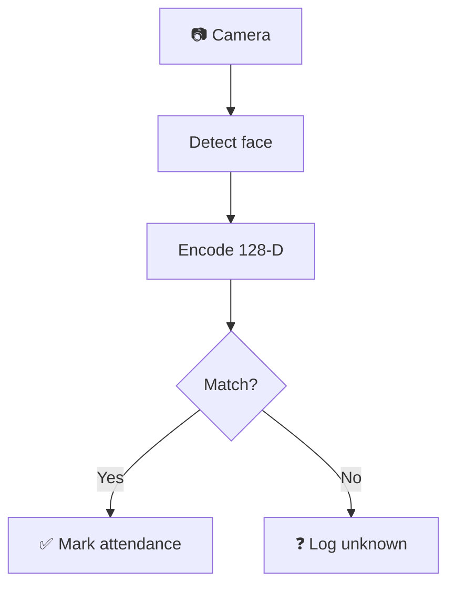

<!-- ============================================================
  GitHub Profile README — Md Golam Rabbi
  Repo name must be exactly: mdgolamrabbi22/mdgolamrabbi22
  ============================================================ -->

<div align="center">


<a href="https://git.io/typing-svg">
  
</a>

<br/>


</div>

---

## 👋 Hello, I'm Rabbi

```python
class GolamRabbi:
    def __init__(self):
        self.role      = "Aspiring AI Engineer"
        self.focus     = ["Computer Vision", "Machine Learning", "Deep Learning"]
        self.based_in  = "Bangladesh 🇧🇩"
        self.education = "Polytechnic Diploma Student"
        self.mindset   = "Build → Break → Learn → Repeat"

    def current_goal(self):
        return "Turn real-world problems into deployable AI products."
```

- 🔭 Currently deepening my skills in **machine learning, deep learning and computer vision**
- 🛠️ Already building **real, working systems** — face recognition, IoT and full-stack apps
- 🌱 Learning in public: strengthening **Python, math for ML, and model deployment**
- 🤝 Looking for **internships, open-source projects and AI collaborations**

---

## 🚀 Flagship Project

<table>
<tr>
<td width="62%" valign="top">

### 🎓 [Face Recognition Attendance System](https://github.com/mdgolamrabbi22/Face-Recognation-Attendence-System)

A desktop system that marks class attendance for students **and** teachers using real-time facial recognition, with an admin dashboard, approval workflow and PDF / CSV reporting.

- 🧠 128-D face encodings, distance-based matching, unknown-face logging
- ⏱️ Two-phase **entry / exit** scan logic tied to the live class routine
- 📷 Multi-camera support (phones as IP cameras)
- 🗄️ MySQL with pooled connections, bcrypt-secured admin access


</td>
<td width="38%" align="center">



</td>
</tr>
</table>

---

## 🛠️ Tech Stack

<div align="center">

**🤖 AI / ML**


**💻 Languages & Development**


**🔌 IoT, Tools & Platforms**


</div>

---

## 🧭 My AI Engineering Roadmap

I believe in showing the path, not just the destination. Here's where I am right now:

| Stage | Focus | Status |
|:---|:---|:---:|
| **01 · Foundations** | Python, NumPy, Pandas, Git | ✅ Done |
| **02 · Computer Vision** | OpenCV, face detection & recognition | ✅ Built a project |
| **03 · Machine Learning** | scikit-learn, model evaluation, feature engineering | 🔄 In progress |
| **04 · Deep Learning** | Neural networks, CNNs with PyTorch / TensorFlow | 🔄 In progress |
| **05 · Math for ML** | Linear algebra, probability, calculus | 🔄 Ongoing |
| **06 · MLOps & Deployment** | Docker, REST APIs (FastAPI), model serving | 🎯 Next |
| **07 · Advanced** | NLP, transformers, LLM applications | 🎯 Planned |

---

## 📦 Other Projects

| Project | Description | Stack |
|:---|:---|:---|
| 🏫 [**Institute Management System**](https://github.com/mdgolamrabbi22/Institute-Management-System) | Web platform to manage institutional operations | `PHP` `MySQL` |
| 🗓️ [**Routine Management System**](https://github.com/mdgolamrabbi22/Routine-Management-System) | Class routine scheduling and management app | `Java` |
| 💧 [**Water Level Monitoring System**](https://github.com/mdgolamrabbi22/Water-Level-Monitoring-System) | IoT water-level detection with alerts | `C++` `Arduino` |

---

## 📊 GitHub Activity

<div align="center">


</div>

---

## 🎯 2026 Goals

- [x] Ship a complete computer-vision project end to end
- [ ] Publish **3 machine-learning projects** with clear write-ups
- [ ] Train and deploy a **CNN image classifier** as a live API
- [ ] Contribute to an **open-source AI repository**
- [ ] Maintain a consistent **weekly commit habit**

---

## 🏆 Trophies

<div align="center">


</div>

---

## 🤝 Let's Connect

<div align="center">

<a href="https://www.linkedin.com/in/YOUR-LINKEDIN-ID"></a>
<a href="mailto:YOUR-EMAIL@example.com"></a>
<a href="https://github.com/mdgolamrabbi22"></a>

<br/><br/>

> *"The best way to predict the future is to build it."*


</div>
